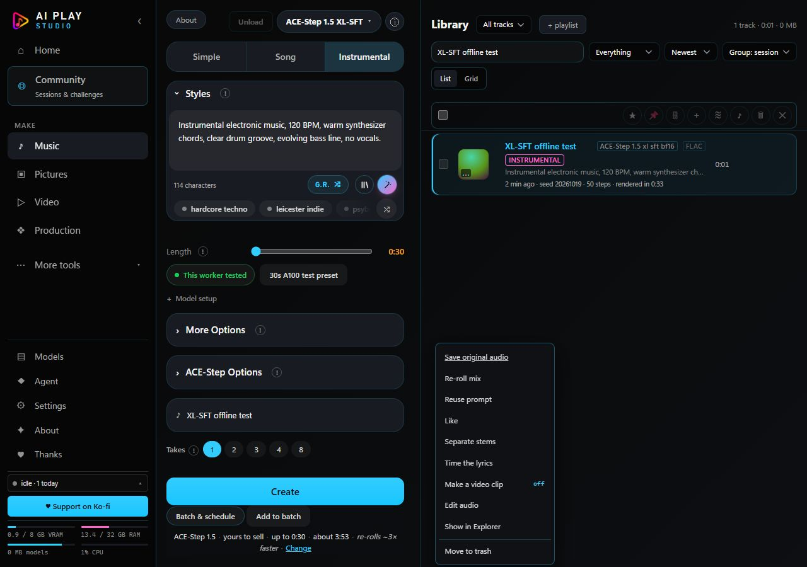
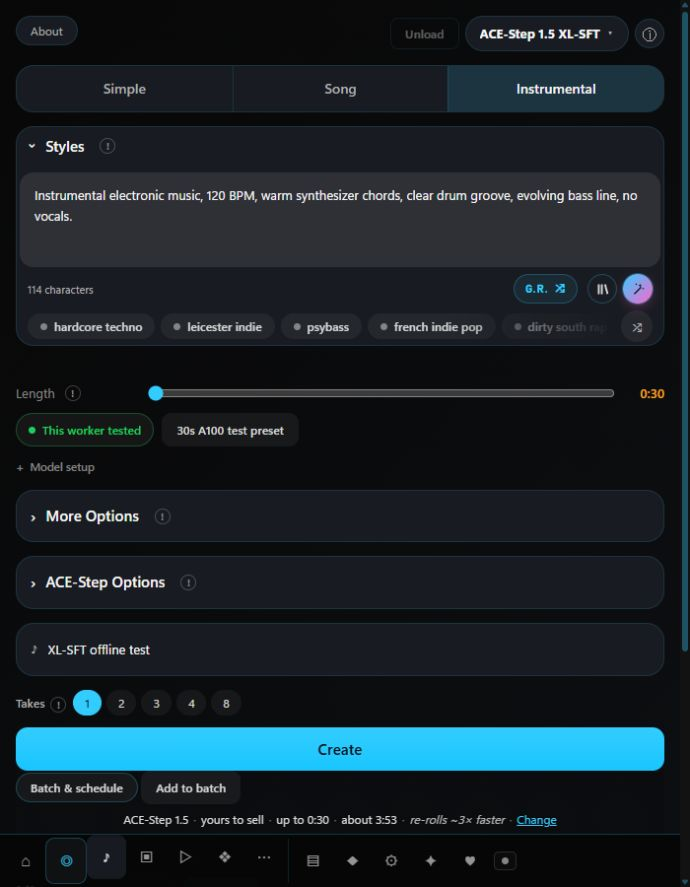

# XL-SFT Music integration

## Audit and implementation plan (before source edits)

Baseline: Nemesis `dd50929b231af4172e755200e7ecf4af90856095`. Existing untracked audit is preserved.

Already working: local and remote ACE inventory; selected-DiT rejection in the generation route; official split-artifact workflow builder; existing Music queue; authenticated/safety-checked worker submission and worker-side schema validation; cancellation reconciliation; streamed checksums and output adoption into the normal song library; Music progress/failure messages, player, library downloads/export and generation provenance. YuE2, standard ACE and MiniMax use these established paths.

Actual gaps:

- Music requests omit DiT/planner identities and depend on separately saved preferences; the shelf silently falls back to another planner when the preferred one disappears.
- The form and generation route turn ACE instrumentals into `[Instrumental]`, while the accepted XL-SFT workflow used empty lyrics.
- The A100 workload has no reproducible Music preset or per-form evidence/readiness indicator. A setup sample currently fills a different acoustic prompt.
- Duration is inside the general advanced settings. ACE advanced options are already collapsible.
- Remote ACE exposes local LoRA/cover controls although this music path submits no remote asset bindings and validates LoRAs against this PC's disk.
- ACE generation provenance omits planner temperature and exact hardware-reference scope.

Minimal plan:

1. Add a pure ACE request adapter and reuse the current graph builder, profile evidence and file/readiness machinery. Pin explicitly requested model/planner names, rejecting missing choices without substitution.
2. Add a guarded, read-only Music readiness check for the actual form, distinct from historical hardware evidence and current-worker inference receipts. Preserve local checksum caching and existing worker setup checks.
3. Add an explicit A100 reference preset in Music; retain normal editable prompts, lyrics/mode and duration. Move the existing duration control into view for ACE, without deleting IDs. Hide unsupported remote ACE LoRA/cover controls; preserve their local path.
4. Keep generation on `/api/generate` and the existing queue/worker. Associate effective settings and scoped reference identity with normal output provenance.
5. Exercise actual request/graph/queue/worker/adoption code with synthetic workers and valid offline audio. Check selector, readiness, mode/lyrics, alternate durations/settings, cancellation/failure, playback and export. Inspect the real Music markup/modules at desktop and 700px.
6. Run focused regressions and the complete mandatory gate, commit, push and verify exact published sources. No paid infrastructure or weights downloads.

Synthetic results will be reported separately from the earlier real A100 acceptance. Vocals, changed settings and other hardware require their own live validation.

## Delivered integration

The existing Music page now sends the selected DiT and planner explicitly. Missing saved selections remain visible and fail clearly instead of becoming another model. The optional reference preset reads the existing profile's accepted workload: 30 seconds, instrumental, empty lyrics, 4B planner, 50 steps, CFG 7, seed 20261019 and planner temperature 0.85. Normal form defaults are unchanged.

The existing duration control is visible for ACE. Lyrics and Instrumental/Song stay in the normal form; advanced sampler/planner settings stay in ACE-Step Options. Model setup distinguishes connection, installed files, verified hashes, workflow schema, current-worker inference and historical hardware reference. Historical evidence never sets current readiness. Changing lyrics/mode, planner, duration or sampler settings removes the historical reference. XL-SFT's current verification path requires the manifest's 4B planner; an alternative planner is not covered by those hashes.

Generation still goes through `/api/generate`, JobRunner, the existing graph builder and authenticated worker client. XL-SFT readiness and schema checks run before enqueue; worker-side validation remains in place. Local standard ACE, YuE2 and MiniMax retain their existing paths. Unsupported remote ACE LoRA/reference controls are hidden and rejected at the API boundary; their existing local controls remain available.

ACE progress and library rows now report the effective ACE steps/CFG rather than MiniMax defaults. The library retains selected model/planner, duration, planner settings and scoped reference identity; reuse restores ACE controls. Generation provenance records these effective settings. The player displays a saved execution target; older files receive no invented local/remote attribution.

An additional audited gap was remote export: existing format conversion runs a local ComfyUI graph. **Save original audio** now downloads the adopted file directly, using the existing audio route and byte-range support. Conversion remains available in local mode and is hidden/refused in RunPod mode. No second inference or conversion backend was added.

### Affected files

| Area | Files |
|---|---|
| Music form and player | `web/app.js`, `web/index.html`, `web/ace-music.js` |
| Request preparation and submission | `server/music/ace-comfy-input.js`, `server/index.js` |
| Current readiness and scoped reference | `server/setup-plan.js`, `server/engine/remote-routes.js`, `server/engine/workflow-evidence.js`, `server/engine/remote-models.js` |
| Effective result metadata | `server/jobs.js`, `server/library.js` |
| Regression tests and registration | `server/ace-music_test.js`, `server/ace-step_test.js`, `server/music-batch-ui_test.js`, `server/cross-origin-doors_test.js`, `server/audio-door_test.js`, `scripts/trace_load.mjs`, `.githooks/pre-commit` |
| Report and screenshots | This document and `docs/evidence/music-xl-sft-ui/` |

## Validation evidence

- Focused regression command: `node --test server/ace-music_test.js server/ace-step_test.js server/music-engine-rows_test.js server/engine/remote_test.js server/engine/remote_guard_test.js server/engine/remote_ui_test.js server/cloud-confirm_test.js`. The Music suite contains 14 tests, including the final library/reuse corrections. See `tmp/cloud-manager/ace-music-focused.log` for the combined result.
- Tests cover explicit identities, absence/refusal without fallback, exact reference graph, prompt/lyrics handling, changed settings, local/remote readiness, stale UI responses, stable duration controls, real queue/client/worker submission to synthetic ComfyUI, schema refusal, confirmed cancellation, inference failure, corrupt-output refusal and reconciliation, verified adoption, library metadata, reuse and save/conversion menus. Existing provider suites remain registered and run.
- Full application QA used isolated app data on port 4387, tiny synthetic model-file fixtures, a real authenticated worker and fake ComfyUI. All non-loopback network access was blocked except one synthetic read-only provider response. No production credentials or model weights were used.
- The 30-second request deliberately returned a **one-second synthetic FLAC test tone**, not generated music. It entered the real library, played in the browser (`readyState: 4`, decoded duration 1 second, no audio error), and downloaded through Save original audio.
- Adopted/tagged and browser-downloaded bytes matched SHA-256 `6a5377886d8636c8b18d96f327b10be6f3e879c4244ed25000d561bc9aeef262` (12,365 bytes). HTTP range playback, attachment/nosniff headers, cross-origin refusal and effective planner provenance passed. Receipt: `tmp/cloud-manager/ace-music-http-qa.json`.
- Real form checks at 1280px and 700px covered model/preset, editable Song lyrics, changed duration, readiness, progress/cancellation, library, player and saving. Screenshots below are offline fixture evidence. “This worker tested” refers to that synthetic worker's receipt, not GPU acceptance.
- Publication uses the complete `.githooks/pre-commit` gate with `AIPLAY_PYTHON=tmp/gate-python/venv/Scripts/python.exe`. No hook bypass, suite removal or weaker assertions. The normal commit is created only after that hook exits successfully; exact gate and publication receipts are in `tmp/cloud-manager/ace-music-gate-commit.log` and `tmp/cloud-manager/ace-music-publication.json`.
- The first gate attempt exposed a CRLF-sensitive multiline source marker in the existing batch-planner UI test. Its source reader now normalizes CRLF to LF before extraction; all behavioral assertions remain intact.
- Final review also made historical reference matching require the accepted planner and sampler seeds. Changed seeds and re-roll seeds keep ordinary current-worker receipts separate from the exact historical preset.
- Existing extracted audio-route fixtures now provide the real route's URL context. Their security, abort/handle-release and range assertions remain intact; attachment versus inline playback headers gained explicit coverage.

### Screenshots

Additional progress, player and save views are in the same evidence directory.

## Scope and remaining hardware validation

This is software integration and synthetic end-to-end validation. It does not add real GPU inference evidence. The original A100 acceptance report, artifact hashes and profile evidence remain unchanged. No compatibility is inferred for smaller GPUs, XL-Turbo, XL-Base, vocals, other durations or modified generation settings. A live Music-page smoke test on an authorized compatible worker is still needed to validate those UI-to-hardware interactions beyond the earlier accepted exact A100 workload. Remote model downloads and local-only conversion require their respective existing services; neither was exercised against live hardware here.

The installed application configuration and retained cloud storage were not changed by these tests. The unrelated pre-existing `AIPLAY_CURRENT_STATE_AUDIT.md` remains untracked and outside the publication.
