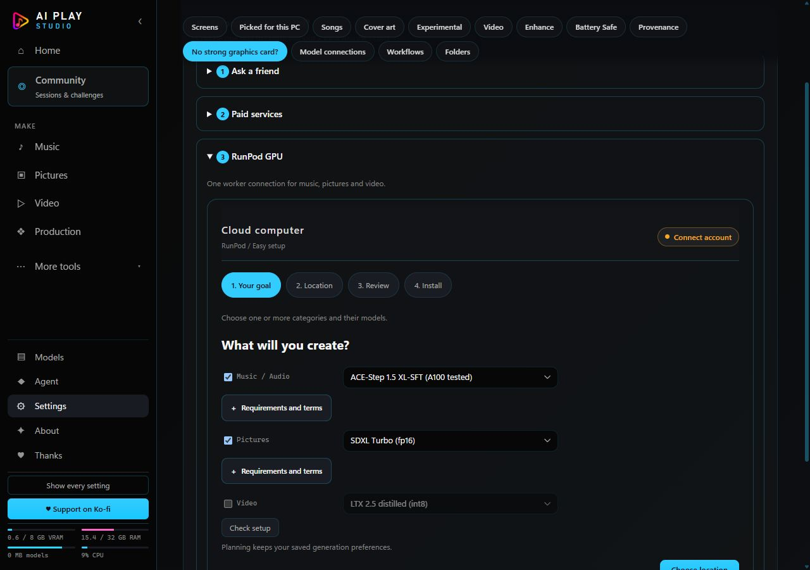
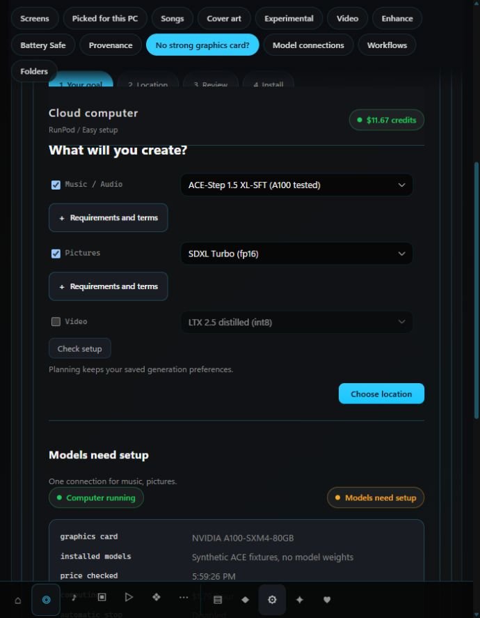
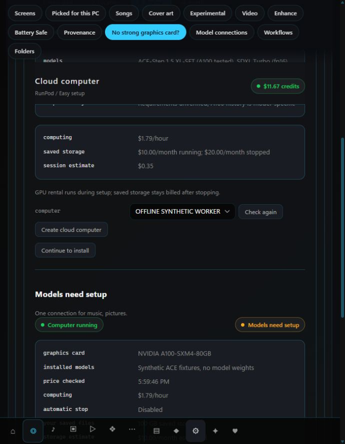
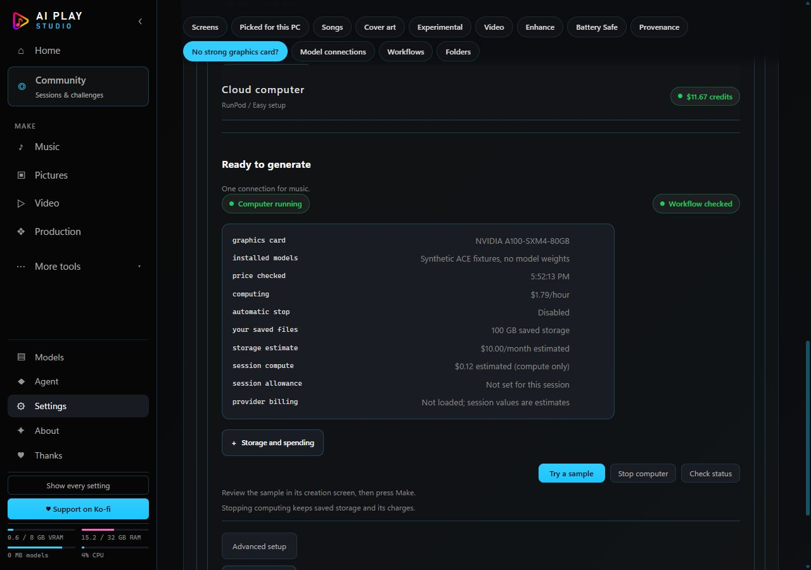
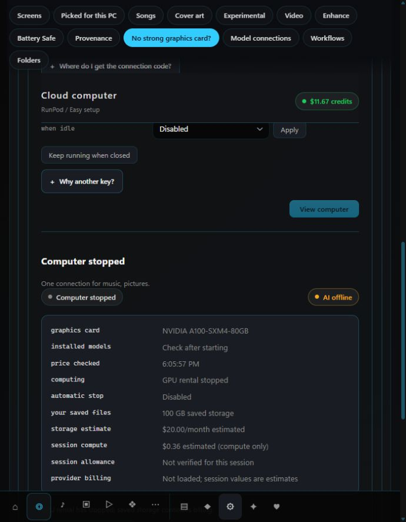

# Beginner setup and cloud management

## Audit and implementation plan (before editing)

Base: `cdcf0f7c5c5f668a60b7e311487f6f15a2ba6bc6`.

Existing infrastructure to retain:

- `shared/model-profiles.js`, `model-bundles.js` and `server/setup-plan.js`
  already supply category combinations, curated models, deduplicated storage,
  exact manifests, compatibility assessments and scoped A100 acceptance.
- `web/setup-plan.js` is the shared Local/RunPod planner; it preserves launch
  mode and generation preferences. Models and Cloud Setup already consume it.
- `web/cloud-computer.js` implements guided setup and uses the existing guarded
  lifecycle routes. `runpod-integrated.js` supplies provider inventory, creation
  review, terms approval, model installation and the Pictures/Video handoff.
- RunPod REST v2, the vault, bounded installer, lifecycle journals and remote
  watchdog already cover discovery, uncertain creation/stop reconciliation,
  price review, output persistence, idle shutdown and separately approved
  acceptance deadlines. Keep these as the only provisioning/lifecycle paths.
- Storage review, estimates for running/stopped volumes, session compute
  estimates and optional provider billing already exist. The ordinary Music
  path and current versus historical readiness were validated in the base.

Actual gaps:

- Guided model selection mixes account connection into its first page; location
  is offered in a separate planner and is easy to overlook.
- Current four pages are Goal/Costs/Install/Ready, rather than separating model
  selection, execution location, review and installation.
- Status and stop options are fragmented; selected models, quote age and
  continued storage cost need to be visible together. Advanced worker state
  can appear ready without checking RUNNING/provider certainty.
- Installation summaries collapse downloading/checksum verification into one
  state, and a late setup reply can restore stale selected-computer readiness.

Minimal-change implementation:

1. Give the shared planner an optional four-stage presentation, retaining its
   existing model controls and install routes. Use the same planning controls
   for Local and RunPod; explicitly preserve the launch-mode boundary.
2. Reorder Cloud Setup to Models/Location/Review/Install and keep the selected
   cloud computer's management summary available outside those steps.
3. Derive beginner state/actions from existing lifecycle/worker/install data;
   expose safe stop/finish/check actions without adding mutations or retries.
4. Show model/download/storage review, provider-check age, separate compute and
   storage estimates, protection and any current bounded-session policy.
   Never apply a historical acceptance deadline to a new session.
5. Reject stale setup replies; make downloading, verifying, paused and failed
   model states legible. Preserve terms, hashes and supported import handling.
6. Add offline regression and actual-browser fixtures, inspect desktop/700px,
   run focused suites and the unchanged complete mandatory gate, then commit,
   publish to Nemesis and verify immutable published files.

All work is software-only. Do not change installed settings or credentials,
contact real RunPod resources, download weights or modify retained storage.

## Delivery results

The existing shared planner now has Models / Location / Review / Install stages.
Cloud Setup uses those stages with the same category/model controls, including
combinations. A local plan opens the existing Models installation path; changing
the plan does not switch launch mode, engine preferences or credentials.

The cloud management summary remains available independently of the setup step.
It shows the selected card, verified installed bundles, separate computer/AI
states, provider-rate check time, tracked compute estimate, recurring storage,
provider-reported billing when loaded, and protection status. Ordinary Stop,
Finish job and stop, Stop now and Check status delegate to the existing guarded
controls. Finish-and-stop requires the existing remote shutdown credential;
cancellation keeps its confirmation. Unknown provider/stop state never displays
a successful stop. Failed price-review messages survive status refreshes.

Creation reviews now pin the concrete quoted cloud pool and selected-model
signature. Pool/price/capacity/model changes require another review; no fallback
GPU, replacement creation or new provisioning path was added. Running persistent
storage, stopped persistent storage and temporary-disk estimates are separated.
Previously recorded acceptance allowances/deadlines remain historical; the UI
does not infer fresh session authorization or supervision from an old journal.

The existing worker's read-only cloud status now includes its existing workload
assessment without renewing idle activity. Older workers are labelled when work
cannot be observed. Curated downloads report Downloading / Verifying / Installing
before Ready, with the original hash checks and partial-file recovery. Setup
replies are bound to the selected computer, selection and lifecycle epoch.
Historical XL-SFT evidence still does not establish current installed files.

The optional HF/Civitai browser remains available in Advanced setup. The beginner
path uses the existing curated manifests and workflow checks; advanced imports
keep their existing provider/file restrictions, explicit acknowledgement and
compatibility labels. No additional model/workflow support is implied.

### Changed areas

| Area | Files |
|---|---|
| Guided planning | `web/setup-plan.js`, `web/index.html` |
| Management, recovery, presentation | `web/cloud-computer.js`, `web/cloud-computer.css` |
| Review and installation labels | `web/runpod-integrated.js` |
| Workload projection | `worker/cloud-watchdog.js`, `worker/runpod-worker.js` |
| Installation phases | `worker/model-manager.js` |
| Regressions | `server/engine/remote_ui_test.js`, `worker/cloud-watchdog_test.js`, `worker/model-manager_test.js` |

### Validation

Focused suites: **238 JavaScript tests passed**, zero failures/skips. These cover
the existing Music/ACE/YuE2 paths, Pictures/Video sample handoff, vault/transport
guards, provisioning review/journals, lifecycle reconciliation, storage,
watchdog, model manager and catalog behavior. Added coverage includes:

- No selected computer, initial loading, invalid/uncertain state and unavailable
  workload. Stale setup replies cannot restore stopped/disconnected readiness.
- Start, stop, pending/uncertain stop and meaningful work states; an older
  worker or historical failed installer cannot supply an invented idle/ready
  state or override a repaired current worker.
- A changed model plan invalidates cost approval; reviewed cloud pools are
  locked rather than silently reselected. Existing price/capacity changes,
  uncertain creation, idempotency and invalid credentials remain covered.
- Checksum-verification progress, final hash verification, interrupted download
  recovery and read-only workload polls that do not extend idle shutdown.
- Failed cost reviews remain visible after a read-only refresh.

The complete unchanged mandatory gate passed in the initial run on
22 October 2026 at 15:51:05 UTC. Final UI/recovery corrections were then covered
by focused checks. The complete mandatory gate runs again on the final staged
tree through the normal commit hook; publication is conditional on its success.
The final commit-hook result and immutable publication hashes are retained in
`tmp/cloud-manager/phase3-commit-gate.log` and
`tmp/cloud-manager/phase3-publication.json`.

### Actual browser check (offline)

The real application and worker ran on loopback with isolated app data, tiny
synthetic model files, a synthetic provider and simulated Linux persistent-mount
verification. The worker's existing test injection supplies mount verification;
the production persistence verifier is unchanged. External destinations are
blocked. The only provider actions are in-memory synthetic start/stop operations.

Verified through the UI:

1. Select Music and Pictures, choose My Computer, review the same models and
   open the existing local planner. Installation is disabled in RunPod launch
   mode; `/api/status` continues to report the original launch mode.
2. Return to RunPod, inspect models/download/storage/compatibility review and
   current account credits. Unknown requirements remain explicitly unverified.
3. For the synthetic installed XL-SFT bundle, obtain current workflow readiness
   without claiming current inference or new hardware acceptance.
4. Stop through the ordinary guarded button. Simulated provider reports EXITED,
   GPU rental stopped, saved storage retained and $20/month estimated storage.
5. Review the fresh synthetic restart price and its storage costs, explicitly
   approve the dialog, and observe a single synthetic start.
6. Stop again. Evidence records exactly three simulated actions: stop, start,
   stop; zero generation submissions and zero real provider operations.
7. Desktop 1280px and 700px layouts were inspected; the narrow review had no
   horizontal overflow. Controls, credits, models and storage costs stayed
   legible. A failed storage-safety check was also observed to withhold success
   and preserve the pending/uncertain stop state.

Evidence: [offline lifecycle JSON](evidence/beginner-cloud-phase3/offline-lifecycle.json).
The screenshot prices/balances are synthetic illustrations, not live quotes or
actual charges. This phase ran no GPU inference or model-weight downloads.







Reproduce the browser fixture from the repository root with the bundled Node:

```powershell
node/node.exe docs/evidence/beginner-cloud-phase3/cloud-setup-fixture.mjs
```

Use the documented isolated gate Python environment (or process-only
`AIPLAY_PYTHON` override). Open `http://127.0.0.1:4457/?view=settings#set-hosted`.
The fixture prints its fresh isolated directory and uses ports 4457/4459/4460;
stop that fixture process when finished. No real account credentials belong in it.

### Limits and live follow-up

- No real provider availability, prices, new worker deployment, mount safety or
  live start/stop was validated here. The earlier A100 Music acceptance is
  unchanged; no other GPU/workload inherits it.
- Existing remote computers need the existing guided worker update to obtain
  workload reporting and granular installation phases. Older workers remain
  usable through their existing paths; missing activity data is labelled.
- Unknown model hardware requirements stay unknown. A recorded A100 peak is
  not a minimum requirement or validation of smaller GPUs or other workflows.
- Download totals are upper estimates; the existing installer reuses verified
  files and resumes partial transfers. Provider billing may lag and storage
  estimates use the existing documented rate basis, not new live pricing.
- No general provider-enforced spending cap was introduced. General sessions
  retain existing alerts/idle policy; separately bounded acceptance sessions
  still need fresh approval and independent supervisor verification.
- No installer was rebuilt, installed application settings/credentials changed,
  retained storage touched or real cloud resources mutated.
