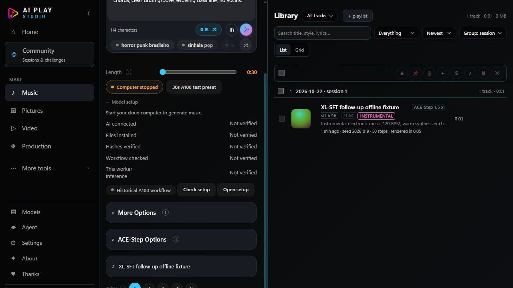
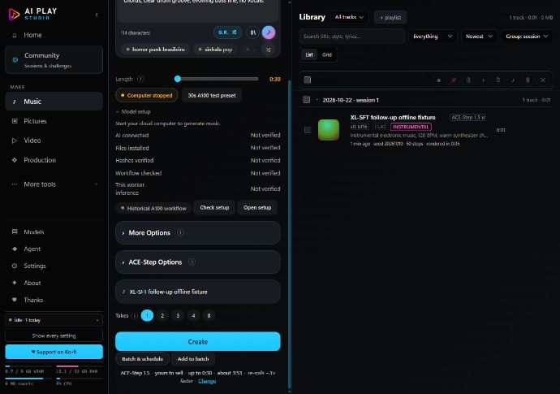

# Music live acceptance corrections

Date: 22 October 2026. Base: `697fd301bef462126e7012d2eac4a4769941835e`.

This is an offline software follow-up to the successful 21 October XL-SFT
Music-page acceptance. It adds no hardware compatibility claim. The accepted
model manifest, workflow evidence and real acceptance output remain unchanged.

## Corrections

- **Current readiness:** the existing Music readiness path checks provider
  RUNNING before contacting the worker and again after file/schema checks.
  Results bind the selected computer, worker identity and connection. EXITED,
  uncertain provider state, lifecycle operations, connection changes and late
  asynchronous replies cannot preserve or restore current readiness.
- **Historical evidence:** completed matching public workflow receipts remain
  separately available as historical inference evidence. Disconnecting or
  stopping clears current checklist values but keeps the historical display,
  including during periodic refresh. Historical evidence does not establish
  installed files or readiness on another computer.
- **Precision and steps:** the selected curated artifact supplies precision.
  The XL-SFT artifact reports BF16. The effective graph's sampling steps and CFG
  feed receipts, library metadata and provenance. The accepted preset records
  50 steps and CFG 7. Custom artifact names and older output rows do not acquire
  guessed precision. Other providers keep their existing metadata paths.
- **Audio tags:** existing tagging/export paths carry steps, precision, model
  artifact and planner into supported tags. Unrelated existing metadata is
  preserved; managed provenance still obeys the existing privacy setting.
  Identical metadata does not replace the audio file. Original and tagged
  SHA-256 values are recorded separately for newly tagged ACE output.
- **Read-only duration:** `Library.durationOf` explicitly invokes the tagger's
  `--probe` mode. It only reads duration and updates the sidecar cache; it never
  stamps generic metadata onto the audio. Regression checks cover untagged and
  already tagged files, preserved metadata and both checksums.

No bulk repair or rewrite of historical audio is performed. Container metadata
support still differs by format; the existing WAV comment/disclosure behavior
is preserved. Unknown historical precision stays unknown.

## Files

- `server/engine/remote-routes.js`, `remote-client.js`, `server/setup-plan.js`:
  lifecycle binding and separate historical evidence.
- `server/music/ace-comfy-input.js`, `server/jobs.js`, `server/index.js`:
  artifact precision, effective sampling settings, status and export plumbing.
- `server/library.js`, `server/tag_audio.py`: checksums, safe tagging and probe.
- `web/ace-music.js`, `web/app.js`: readiness invalidation and history display.
- `server/ace-music_test.js`, `server/daw/tag_bounce_test.py`: regression tests.
- `server/fit_test.js`: fresh-install tests now use isolated application data.
  The previous full gate exposed this fixture reading the installed user's
  XL-SFT selection and changing download totals. Its original assertions and
  thresholds are unchanged. No application settings were changed to fix it.

## Validation

- Focused Music/readiness/provider suites: **170 passed**, zero failures or
  skips, including **20 Music integration tests**.
- CPU audio-tagging suite: **27 assertions passed**. Includes lossless 24-bit
  samples, effective steps/BF16, companion identity, metadata preservation,
  privacy behavior and avoiding identical rewrites.
- Fresh-install hardware fit suite: **98 assertions passed**.
- Full mandatory repository gate: **passed**, exit 0 on 22 October 2026 at
  14:51:03 UTC, using the established isolated CPU Python environment without
  changing the gate. Log integrity and environment are recorded in
  `evidence/music-live-followup/gate-summary.json`.

### Full-app offline check

The real application, ordinary Music form, job queue, authenticated worker,
output adoption, tagger, library, player and original-audio save path ran against
a synthetic ComfyUI/provider fixture. External networking and provider mutations
were blocked in that fixture. The four model files were tiny synthetic fixtures,
not model weights. The output was a one-second test tone, not new GPU inference.

Observed results:

1. The 30-second reference **request** selected XL-SFT, its 4B planner, 50 steps,
   CFG 7 and empty instrumental lyrics. The synthetic output was one second.
2. The library, embedded FLAC tags and provenance all reported 50 steps/BF16.
3. Original SHA-256:
   `c7678f1420da7f855cd22a308409f3c14b63eb5379faa665f3ea6880b4e85a74`.
4. Tagged SHA-256 and saved-original download SHA-256 both:
   `b91eea7bc826672ac62d59a8f54216a9062a646e34f054eb1b9e9708e9706495`.
5. The existing HTML audio player decoded the FLAC, reported duration 1 second
   and advancing playback time without a media error after compute stopped.
6. A fake provider transition to EXITED invalidated current readiness even
   while the synthetic worker remained reachable. Every current checklist
   value became Not verified. Historical workflow/inference evidence remained.
7. Desktop 1280x900 and 700x900 layouts were inspected. Screenshots below show
   stopped state and retained historical evidence after periodic refresh.

Detailed local fixture evidence: `tmp/cloud-manager/music-followup-ui-evidence/`.
Focused logs and full gate logs: `tmp/cloud-manager/music-followup-*.log`.

## Scope and publication

No RunPod resources were created, started, restarted, stopped, terminated,
resized or deleted for this follow-up. No model weights were downloaded and no
retained storage was changed. No new paid GPU test was run. Existing generation
providers, playback, UI structure and inference paths remain in use.

Publication is the reviewed source commit on the existing Nemesis fork, verified
against the remote branch and immutable published source blobs after pushing.
This task does not create a new Windows installer or update a retained Pod.
